# Trakt OG Toolkit

An **unofficial** userscript for [og.trakt.tv](https://og.trakt.tv) that brings back useful bits of classic Trakt that
og doesn't have yet. It uses og's session to call the documented Trakt API. Not affiliated with or endorsed by Trakt.

## Install

1. Install [Violentmonkey](https://violentmonkey.github.io/) or [Tampermonkey](https://www.tampermonkey.net/).
2. Open [`dist/trakt-og-toolkit.user.js`](dist/trakt-og-toolkit.user.js), choose **Raw**, and confirm the install.
3. Sign in on og.trakt.tv. Features marked *signed in* below need it; the rest work from the page.

Installed copies update themselves from `main` when a new version is released. A copy installed from a saved file, or
an old copy that doesn't find the update, needs one reinstall from the link above.

Every feature has a **toggle** in the userscript menu (✅ on, ⬜ off). All are on by default.

## Features

### Custom links

Your own links to other sites and your media servers, in the title sidebar and in og's Watch Now dialog. Presets for
IMDb, Letterboxd, JustWatch, Stremio, Plex, Jellyfin, Radarr, Sonarr and more open the exact title, season or episode
where they can. Season and Episode pickers appear on show pages for links that need them.

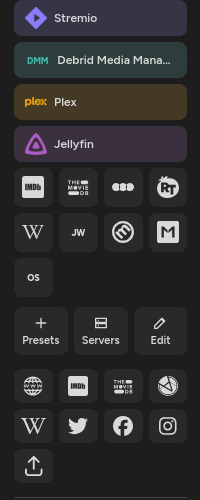

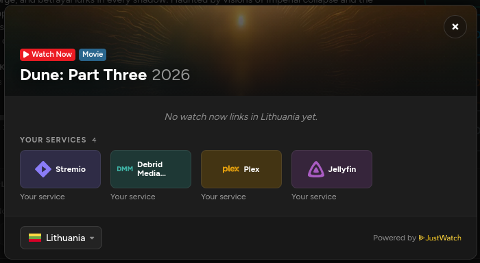

All presets and the template placeholders: [docs/custom-links.md](docs/custom-links.md).

### Season chart

An episode ratings chart on each season page, from the API or og's displayed ratings. Episodes with under 10 votes are
hollow and left out of the average. *Signed in*, your own ratings are a second line, with **Your average** in the
summary and on each season card.

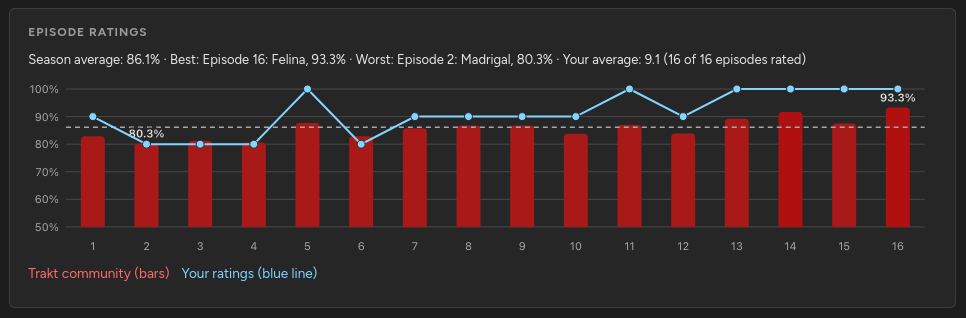

### Trakt ratings chart

*Signed in*, movie, show, season and episode pages get a compact ratings chart under the overview: ten bars with vote
counts and the average, plus og's stats tiles when there is room. It only appears when it fits, so og's layout never
moves.

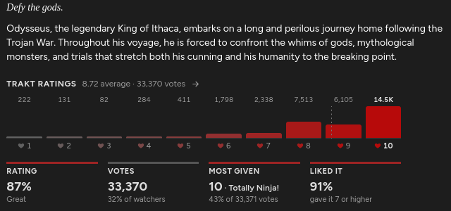

### Add to library and Add to watchlist

*Signed in*, title pages get **Add to library** and **Add to watchlist**. Each hides once the title is already there,
and success notices offer **Undo**.

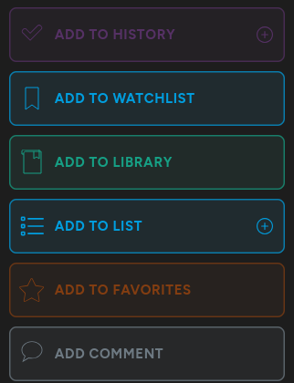

Movie and show cards and every credit on a person's page get a watchlist shortcut, and **Watchlist all** adds every
shown credit at once.

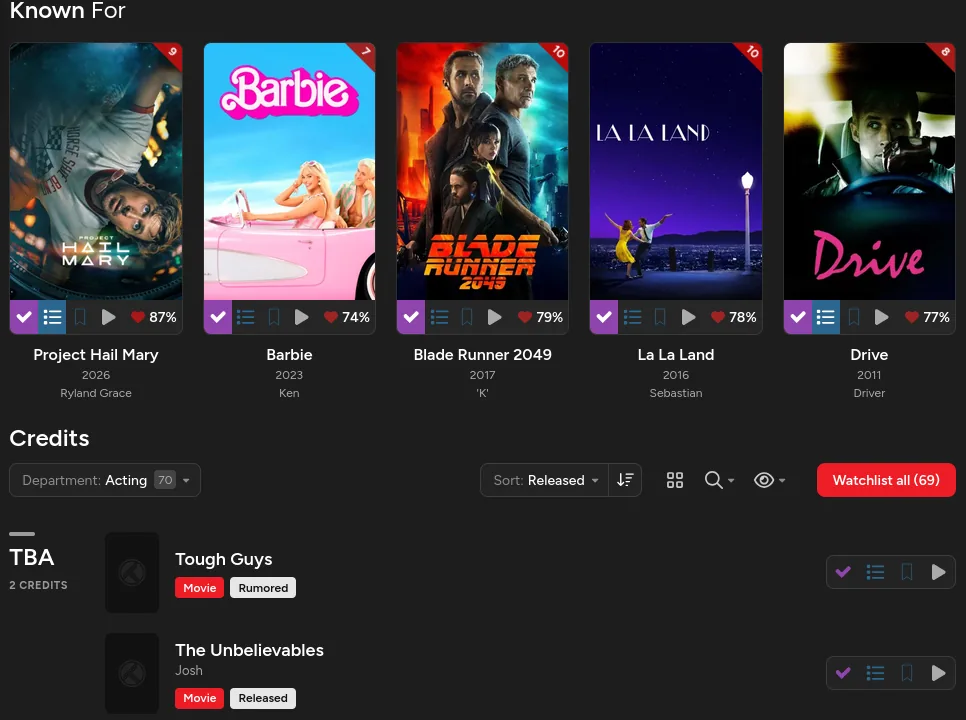

### Paused playback

*Signed in*, your **Progress** page gets a **Paused playback** section for clearing items one by one, in bulk or by
age. Movie and episode pages show saved progress with **Clear**, and **Save progress…** sets a percentage without
marking the title watched.

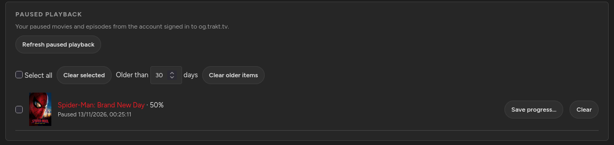

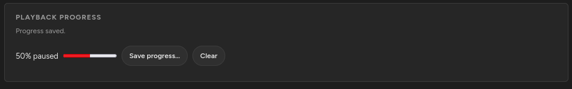

### All lists

og's Lists dropdown on a profile gains **All lists**: personal, collaboration and liked lists in one scroll.
Collaborations and liked lists need you *signed in*.

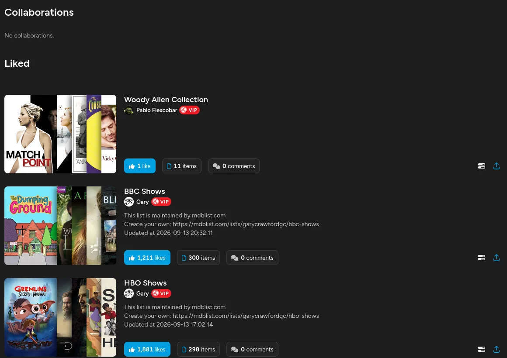

### List previews

Each poster in a list card's preview opens its title. *Signed in*, posters show your rating in their corner, on the
front poster and on the others as you hover over them.

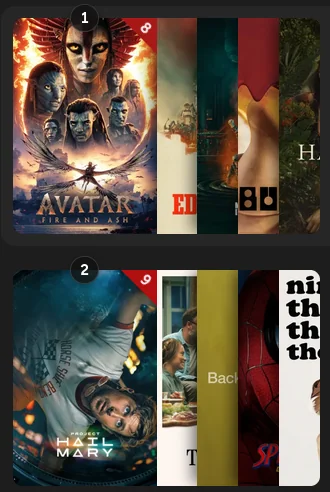

### Pick something and Export CSV

*Signed in*, on a watchlist, **Pick something** picks a random title from the current
All/Movies/Shows/Seasons/Episodes filter, with **Pick again**. It reads up to 5,000 entries.

On a list or watchlist page, **Export CSV** downloads the whole list with rank, type, title, year, season/episode,
ids, listed date and notes, as a UTF-8 CSV that opens cleanly in Excel.

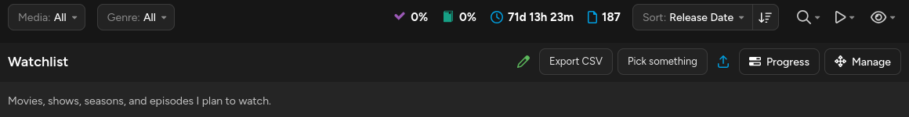

### Month in review

*Signed in*, the dashboard gets a card with last month's plays, hours, ratings and comments. Arrows step back through
earlier months.

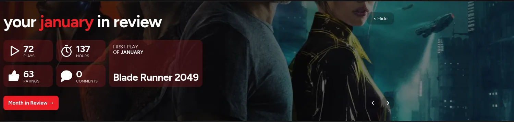

### Pronounce

On person pages, plays the name from Forvo, or links to Forvo's search when there's no recording.

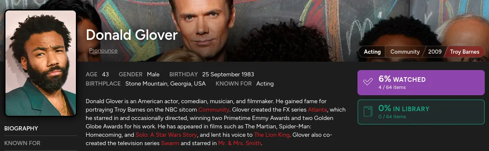

## More

- [Sign-in and Trakt API use](docs/api.md): what the toolkit reads from og's session and how it calls the API.
- [Custom links](docs/custom-links.md): presets and template placeholders.
- [Development](docs/development.md): building, tests and the og drift check.

## Licence and credits

MIT, see [LICENSE](LICENSE).

Written from scratch. Ideas came from [saad1430/tampermonkey](https://github.com/saad1430/tampermonkey) (MIT) and
[Fenn3c401/Trakt.tv-Userscript-Collection](https://github.com/Fenn3c401/Trakt.tv-Userscript-Collection) (GPL-3.0); no
GPL code was copied.
